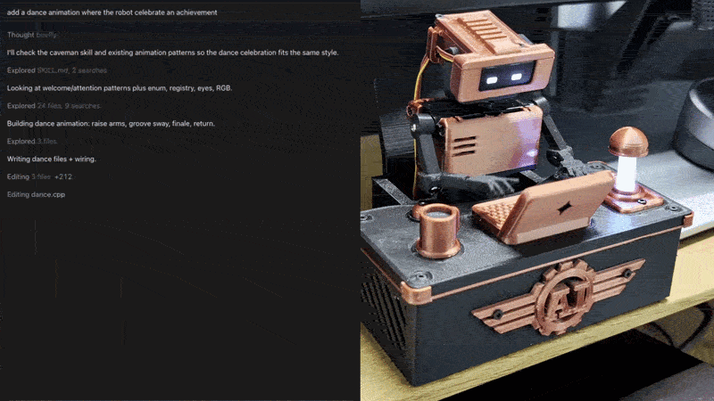
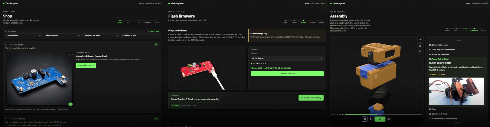
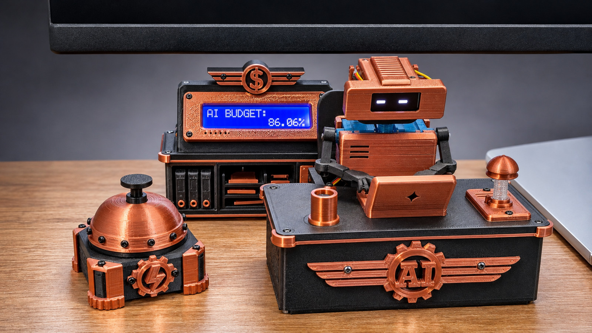
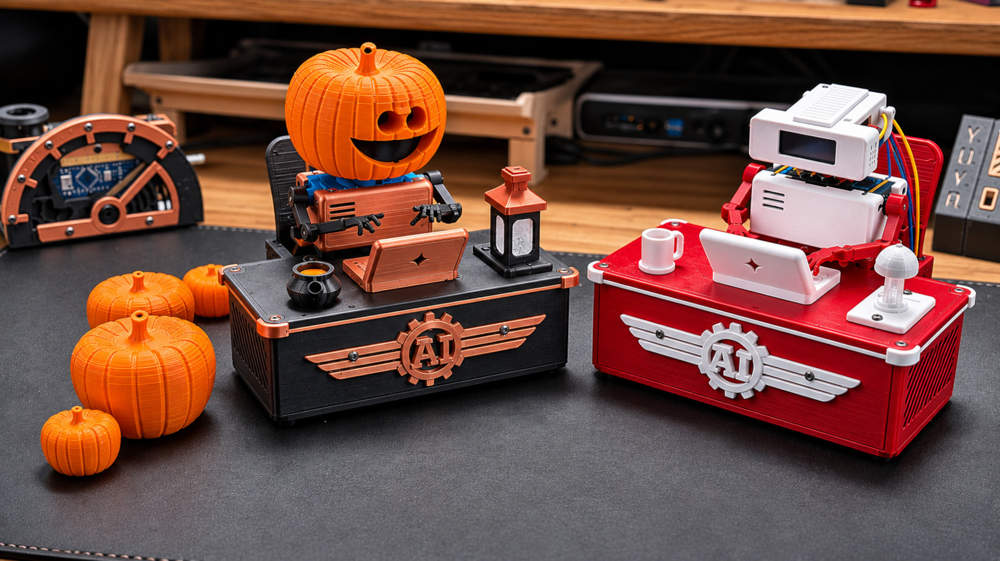
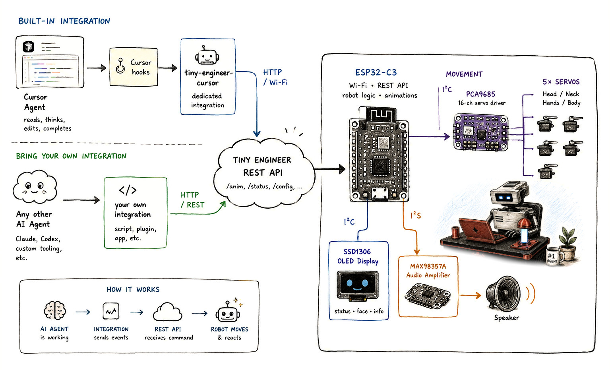

# Tiny Engineer

> Give your AI coding agent a body.

**[Watch the demo](https://youtu.be/RX_QRxdXMjg)** · [Build your own](#build-your-own) · [Mods and accessories](#mods-and-accessories) · [Community builds](#community-builds) · [How it works](#how-it-works)

A small robot on your desk. It moves, changes its face, and rings a bell as your coding AI agent works.

| Your agent… | The robot… |
| --- | --- |
| Reads files | Looks around |
| Writes code | Types |
| Thinks or waits | Looks up |
| Finishes the task | Rings the bell |

Open source. Print the body, plug the ESP32, servos, OLED, and speaker into the main control board, flash it, and it joins your Wi-Fi.

**Works with** Claude Code · Cursor · Antigravity — via [`npx -y tiny-engineer setup`](docs/integration.md) — or Codex, Windsurf, and any script that can POST ([integration guide](docs/integration.md) · [HTTP API](docs/api.md)), including speech through [`POST /play`](docs/api.md#post-play).

## Build your own

The whole build is a short guided path: buy the assembled board and the plug-in modules, print the body or order the prints, flash the firmware from Chrome or Edge over USB, then follow a 3D step-through that slides each part into place. Parts push into labeled sockets. No soldering. A phone wizard joins your Wi-Fi when the body is together.

**[Start the build guide at tinyengineer.dev →](https://tinyengineer.dev/build)**

[Shop](https://tinyengineer.dev/build/shop/) · [Print](https://tinyengineer.dev/build/print/) · [Flash](https://tinyengineer.dev/build/flash/) · [Assembly](https://tinyengineer.dev/build/assembly/) · [Setup](https://tinyengineer.dev/build/setup/)

## Mods and accessories

Two extras you keep in reach while an agent is working.

- **[Push button](mods/bell_button/README.md)** — a fully configurable shortcut on the desk. One press opens Music, a double-click opens Cursor, a hold starts Claude Code, or you point each gesture at any other app or script.
- **[LCD cabinet](mods/lcd_cabinet/README.md)** — keeps the plan budget left in view on the desk. After each agent turn the number updates, so you always know how much is left before the next prompt. The screen is customisable and can display whatever you want.

**[All customisations at tinyengineer.dev →](https://tinyengineer.dev/customise)**

## Community builds

Finished builds, mods, and desk setups live in **[Show and tell](https://github.com/jamro/tiny-engineer/discussions/categories/show-and-tell)** on GitHub Discussions - browse what others made and post photos of yours.

**Built one? [Share in Show and tell →](https://github.com/jamro/tiny-engineer/discussions/categories/show-and-tell)**

## How it works

Your agent (or a hook script) sends poses over **Wi‑Fi HTTP** or **USB serial**. The **ESP32-C3** runs the firmware, optional Wi‑Fi/REST, USB CDC control, and drives the servos, face, and speaker.

**Clients**

- **Default** — [`npx -y tiny-engineer`](https://www.npmjs.com/package/tiny-engineer) (`setup` / `hook`) for Cursor, Claude Code, Antigravity (HTTP or `--transport serial`)
- **Advanced** — `POST /anim` ([HTTP API](docs/api.md)) or framed USB serial ([serial.md](docs/serial.md))

Details: [Integrations](docs/integration.md) · [HTTP API](docs/api.md) · [USB serial](docs/serial.md) · [Cursor hooks](docs/hooks.md)

Print it, connect it, change the CAD, or hook up another agent. Issues and PRs welcome - especially new integrations. [CONTRIBUTING.md](CONTRIBUTING.md) · [SECURITY.md](SECURITY.md) · [CODE_OF_CONDUCT.md](CODE_OF_CONDUCT.md)

## License

- **Software** (firmware, integrations, scripts, documentation) — [MIT](LICENSE)
- **Hardware designs** (CAD source and printables in [`3d_models/`](3d_models/) and under [`mods/*/3d_models/`](mods/); KiCad PCBs in [`hardware/`](hardware/)) — [CERN-OHL-S-2.0](3d_models/LICENSE)

See [LICENSING.md](LICENSING.md) for scope and effective date. The **Tiny Engineer** name and logo are not licensed - see [TRADEMARK.md](TRADEMARK.md).
