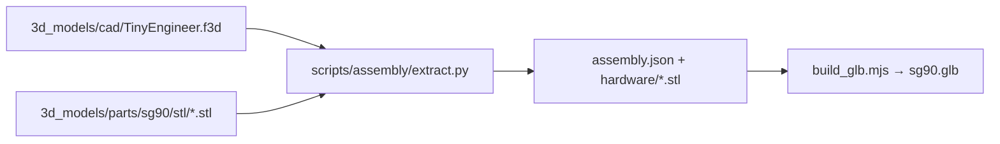

# 3D assembly model

The **[assembly viewer](https://jamro.github.io/tiny-engineer/assembly/)** shows the robot assembled from the same meshes you print. CI builds its 3D model from the repository. Nothing generated is committed.



## Viewer

[`web/assembly/`](../../web/assembly/) on GitHub Pages, plain ES modules in [`web/js/assembly/`](../../web/js/assembly/), with Three.js from a CDN. It loads `models/sg90.glb`, which the [Pages workflow](../../.github/workflows/pages.yml) builds on deploy.

- **Build steps:** the build from [assembly.md](assembly.md), split into small steps. Each step shows the robot so far, slides the new parts in, frames them, and lists screws, the section photo and a link to the guide. Play, ← / →, or jump to a section. `#s=12` links to step 12.
- **Colours:** click a part, or its name in the list, and pick a filament colour or a custom one. Each print set (copper `PartsSetA`, black `PartsSetB`) has one control for all its parts. Defaults are the colours as designed ([order-parts.md](order-parts.md)).
- **Share:** changed colours live in the URL hash (`#c=Head.c8312c~Hat.c8312c`) and in the browser's storage. **Copy link** copies the URL.
- **Move:** a slider per servo joint, in the firmware's −1..1 pose scale ([robot-movement.md](../robot-movement.md)), and short loops built from the firmware's pose constants (typing, talking, ring the bell, wave). Each servo turns about its shaft, read from the model (`web/js/assembly/joints.js`): body → neck → head, body → hands. The range is a choice (±10° stock, ±25°, ±40°): calibrated limits differ per robot. Build steps show every servo at 90°.
- **Explode** spreads the parts out. **Electronics** hides the servos, OLED and control board.

### Steps

[`web/assembly/steps.json`](../../web/assembly/steps.json): sections that follow `assembly.md` (`doc` is the heading anchor, `photo` a file in `assembly_visuals/`), each with steps:

```json
{ "title": "Seat the OLED", "text": "…", "add": ["OLED"], "from": [0, 0, 40], "screws": "2 × M2×8" }
{ "title": "Lower the body onto BellyJoint", "text": "…", "add": [], "move": ["Belly", "Chest", "…"], "from": [0, 0, 70] }
```

- `add`: part ids from the model (`assembly.json`) that appear in this step. Every part is added exactly once.
- `move`: parts added earlier that move into place in this step, together: a sub-assembly built off the robot (the head before it goes on the chest, the whole desk before it meets the chair). Until this step they wait at `from`, added to any later moves of theirs, so a sub-assembly is built where it waits and travels as one piece.
- `from` / `fromEach`: where the added or moved parts slide in from, relative to where the step leaves them (mm, CAD frame: +x the robot's front, +y its left, +z up).
- `focus`: parts to frame (default: the parts the step adds or moves). `ghost`: parts drawn see-through (the desk while the board goes in).
- `allow`: overlaps this step lets through, `{ "parts": [a, b], "mm": 2.5, "why": "…" }`, for joints that only go together by flexing or tilting a part, which the viewer's straight slides cannot show. Top-level `fits` does the same for every step and for the finished robot: the servo shafts, modelled 0.3 mm over their printed pockets.

CI checks the steps against the extracted model (`check_steps.mjs`) and for clipping (below). When a part is added to the CAD, add it to a step.

### Clipping check

[`check_clipping.mjs`](../../scripts/assembly/check_clipping.mjs) replays every step on the meshes. Each part that moves is walked along its path in 1 mm steps and tested against every part shown. Then the finished robot is checked pair by pair. Depth is measured on the triangles, not on bounding boxes: points spread 0.8 mm apart over one part's surface are tested inside the other (ray parity over a bounding volume hierarchy), and the deepest one sets the depth ([`clipping.mjs`](../../scripts/assembly/clipping.mjs), no dependencies). Faces that only touch measure 0, so mating parts pass. Anything deeper than 0.3 mm fails, unless `fits` or the step's `allow` covers that pair to that depth. Allowed overlaps are listed in the output.

```bash
node scripts/assembly/check_clipping.mjs artifacts/assembly/sg90/assembly.json web/assembly/steps.json [web/assembly/mods/<id>.json] [--tolerance 0.3] [--step 1]
```

```text
step 17 (belly 1) "Thread the three leads": Belly × servo-body clips 6.40 mm at 31 % of the move
```

A failure names the step (number overall, then section and number in it), the two parts, how deep they meet and where along the move. To fix one, slide the part in from a direction that clears what is already there, or build it into a sub-assembly that is mounted later with `move`. Stock takes about 35 s, the Halloween mod about a minute. `build.sh` runs it for stock and every mod. A mod's config can add `fits` for overlaps that come from how its parts are lined up with the stock robot (`align`).

Local preview: build the GLB into `web/assembly/models/sg90.glb` (commands below), then `python3 -m http.server -d web 8000` and open `http://localhost:8000/assembly/`.

## Mods

A mod shows on the viewer when it has a config in [`web/assembly/mods/`](../../web/assembly/mods/) (`#m=<id>`, the **Model** switch). [`halloween.json`](../../web/assembly/mods/halloween.json) is the example:

- `f3d`, `parts`: the mod's design and its exported parts (`mods/<id>/3d_models/`). `extract.py --mod` reads only the parts the mod exports, checked against its STLs as for stock.
- `align`: how each group of the mod's parts lines up with the stock robot. A mod design is its own arrangement, not the stock robot's frame:
  - `component`: the mod keeps a stock component (the Halloween head keeps `Head`), so its frame is shared. Exact.
  - `centre` + `floor`: centre a part on a stock part and stand it on that part's floor (the lamp on the stock lamp's axis, the cauldron on the mug's spot). `check` fails the build if a footprint lands off.
  - `at`: a prop on the floor beside the desk.
- `replace` (`Mug` → `Pot`), `remove` (`Hat`), and same-id parts (`Head`, `LampBase`, …) take the stock parts' places. `colors` are the mod's defaults.
- `steps`: rewritten `sections`, `patch`ed steps (by index in the section) and `append`ed sections on top of `steps.json`. Replaced and removed ids follow automatically, in `add`, `move`, `allow` and `fits` alike. A mod part that rides on a stock sub-assembly must be in that sub-assembly's later `move`s: Halloween patches the body's move onto the chair so the pumpkin goes with the head.
- `fits`: overlaps of the mod's parts that the clipping check lets through, as in `steps.json`.

[`build.sh`](../../scripts/assembly/build.sh) builds every mod in that folder after the stock model, and checks its steps against its parts.

## How placements are found

The Fusion add-in exports each part in its **print** pose (flat on the bed, see [adding parts](adding-parts.md#print-ready-copy-print_layout)). To place it in the robot, the extractor reads the `.f3d` directly. It does not need Fusion:

- The design stores each component's bodies in that component's own frame, plus one solved transform per occurrence. That covers the assembled robot and the copies under `PRINT_LAYOUT`.
- A part's **print → assembled** transform is its assembled occurrence's transform times the inverse of its `PRINT_LAYOUT` occurrence's transform.
- **Hardware** (`Servo` ×5, `OLED`, `MainControlBoard`) has no exported mesh. Its mesh is tessellated from the design's own bodies and placed by its occurrence transform. Servos are named after the joint that seats them (`Head Servo` → `servo-head`, `Neck - Body` → `servo-neck`, `UpperArm Left/Right` → `servo-arm-left/right`, `ChairServo` → `servo-body`).

The `.f3d` format is not documented. It is read with [ezf3d](https://github.com/AlexSabaka/ezf3d) (MIT, pinned in [`scripts/assembly/requirements.txt`](../../scripts/assembly/requirements.txt)). Every placement is checked before it is used, and the run **fails** when a check fails:

| Check | Passes when |
| --- | --- |
| Print transform | At least 16 of one solid's B-Rep vertices, and 50 % of them or 100 in all, land within 0.05 mm of the exported STL's vertices. Round parts with few vertices (bell, lamp cap, coffee, diffuser) are checked by the bounding box of their surface instead, to 0.3 mm, or pass when at least 6 of their vertices and 85 % coincide. |
| Fallback | A part without a usable print transform (the mirrored upper arm, printed as `UpperArm.stl`, and the mug, whose print record is stale) is fitted to its STL with iterative closest point, then held to the same check. |
| Joints | Every named joint agrees with the transforms of the two occurrences it connects, to 0.05 mm. |

Not 100 % of vertices: a solid blob also keeps earlier solids of the timeline, and a part exported before a small parametric change, such as a screw pilot diameter, keeps its holes slightly elsewhere. The part itself does not move.

## Servo preset

The checks run against **one** preset's STLs: the one the `.f3d` was saved with (currently **SG90**). After changing the saved preset, run the extractor with the matching `--preset`. Other presets need the design saved at that preset.

## Run locally

Python 3.13 (ezf3d requires it) and Node 18+:

```bash
python3 -m venv .venv && .venv/bin/pip install -r scripts/assembly/requirements.txt
.venv/bin/python scripts/assembly/test_assembly.py
node scripts/assembly/test_build_glb.mjs
.venv/bin/python scripts/assembly/extract.py --preset sg90 --out artifacts/assembly/sg90
node scripts/assembly/test_viewer.mjs
node scripts/assembly/test_clipping.mjs
node scripts/assembly/check_clipping.mjs artifacts/assembly/sg90/assembly.json web/assembly/steps.json
PYTHON=.venv/bin/python scripts/assembly/build.sh   # stock + mods -> web/assembly/models/
```

`artifacts/` and `web/assembly/models/` are git-ignored. CI runs the same commands (`assembly` job) and uploads `assembly.json` and the GLB as the `assembly-<sha>` artifact.

### `assembly.json`

```json
{
  "format": 1, "preset": "sg90", "units": "mm", "up": "+z",
  "parts": [{ "id": "Head", "mesh": "3d_models/parts/sg90/stl/Head.stl", "matrix": [16 numbers], "method": "print-layout" }],
  "hardware": [{ "id": "servo-head", "component": "Servo", "mesh": "hardware/Servo.stl", "matrix": [16 numbers] }],
  "joints_checked": [{ "name": "Head - Neck", "mismatch_mm": 0.0 }]
}
```

`matrix` is column-major, as glTF writes it, and takes the mesh to its assembled pose (mm, Z up). The GLB keeps that frame under a root node that turns Z up into glTF's Y up. It stores positions and indices only: the viewer computes normals. A mesh used more than once, such as the servos, is stored once.

## License

The generated model is made from the CAD and part exports, so it is covered by **CERN-OHL-S-2.0** like them ([LICENSING.md](../../LICENSING.md)). The scripts are MIT.
