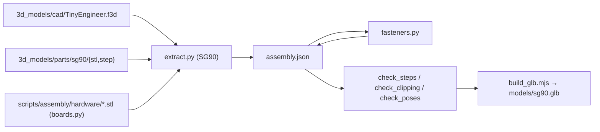

# 3D assembly model

The **[assembly viewer](https://jamro.github.io/tiny-engineer/assembly/)** shows the stock SG90 robot assembled from the same meshes you print. CI builds its 3D model from the repository on every Pages deploy. The only generated files in git are the electronics the CAD does not have ([below](#electronics-the-design-does-not-have)).



## Viewer

[`web/assembly/`](../../web/assembly/) on GitHub Pages, plain ES modules in [`web/js/assembly/`](../../web/js/assembly/), with Three.js from a CDN. It loads `models/sg90.glb`, which the [Pages workflow](../../.github/workflows/pages.yml) builds on deploy.

- **Build steps:** the build from [assembly.md](assembly.md), split into small steps. Each step shows the robot so far, slides the new parts in, frames them, and lists screws, the section photo and a link to the guide. Back / Play / Next sit at the top of the build card; ← / → or jump to a section. `#s=12` links to step 12.
- **Colours:** parts use the design defaults (copper set, black set, white diffuser). There is no colour picker.
- **Move:** a slider per servo joint, in the firmware's −1..1 pose scale ([robot-movement.md](../robot-movement.md)), at a fixed ±25°. Each servo turns about its shaft (`web/js/assembly/joints.js`): body → neck → head, body → hands. Build steps show every servo at 90°.
- **Screws and nuts:** the robot's M2 screws and nuts, in their holes ([below](#screws-and-nuts)), always shown with the electronics when the current step includes them.

Local preview: build the GLB into `web/assembly/models/sg90.glb` (commands below), then `python3 -m http.server -d web 8000` and open `http://localhost:8000/assembly/`.

### Steps

[`web/assembly/steps.json`](../../web/assembly/steps.json): sections that follow `assembly.md` (`doc` is the heading anchor, `photo` a file in `assembly_visuals/`), each with steps:

```json
{ "title": "Seat the OLED", "text": "…", "add": ["OLED"], "from": [0, 0, 40], "screws": "2 × M2×8" }
{ "title": "Lower the body onto BellyJoint", "text": "…", "add": [], "move": ["Belly", "Chest", "…"], "from": [0, 0, 70] }
```

- `add`: part ids from the model (`assembly.json`) that appear in this step. Every part is added exactly once.
- `move`: parts added earlier that move into place in this step, together: a sub-assembly built off the robot. Until this step they wait at `from`, added to any later moves of theirs.
- `from` / `fromEach`: where the added or moved parts slide in from, relative to where the step leaves them (mm, CAD frame: +x the robot's front, +y its left, +z up).
- `focus`: parts to frame (default: the parts the step adds or moves). `ghost`: parts drawn see-through.
- `allow`: overlaps this step lets through, `{ "parts": [a, b], "mm": 2.5, "why": "…" }`. Top-level `fits` does the same for every step and for the finished robot.

CI checks the steps against the extracted model (`check_steps.mjs`) and for clipping (below). When a part is added to the CAD, add it to a step.

Screws and nuts are not listed in `steps.json`: each one names its step in [`fasteners.json`](../../scripts/assembly/fasteners.json), and `withFasteners` (`steps.js`) adds it there. It rides in with the part its head sits on, then slides in along its axis once the step's parts are home (the last 40 % of the step), and moves with its parts in later steps.

### Screws and nuts

[`fasteners.py`](../../scripts/assembly/fasteners.py) adds the M2 screws and nuts of the [screw list](../../3d_models/README.md#screws) to the robot's `assembly.json`, from [`fasteners.json`](../../scripts/assembly/fasteners.json): per line, the part the head sits on, the part it threads into, the length, how many, and the step. It finds them in the parts' STEP exports at the SG90 preset, placed where `assembly.json` has each part.

A line that finds another count than it says fails the build. Meshes: pan head 3.5 × 1.4 mm (JIS B 1122), 2 mm shaft with a point, ISO 4032 nut (4 mm across flats, 1.6 mm). Not drawn: the breakout boards' screws and nuts of the [modular build](assembly-modular.md), the optional second screw of the neck servo, and the servos' own bag screws.

### Clipping check

[`check_clipping.mjs`](../../scripts/assembly/check_clipping.mjs) replays every step on the meshes. Each part that moves is walked along its path in 1 mm steps and tested against every part shown. Then the finished robot is checked pair by pair. Depth is measured on the triangles ([`clipping.mjs`](../../scripts/assembly/clipping.mjs)). Faces that only touch measure 0. Anything deeper than 0.3 mm fails, unless `fits` or the step's `allow` covers that pair. `build.sh` runs it for the stock robot.

```bash
node scripts/assembly/check_clipping.mjs artifacts/assembly/sg90/assembly.json web/assembly/steps.json [--tolerance 0.3] [--step 1]
```

### Pose check

[`check_poses.mjs`](../../scripts/assembly/check_poses.mjs) turns the parts about the servo shafts as the viewer does (`JOINTS` in [`poses.js`](../../web/js/assembly/poses.js), at ±25°) and checks parts that move relative to each other for clipping at 90°, at rest, and with each joint at ±1. `fits` apply as in the step check. Screws and nuts turn with the part their head sits on (`withFollowers` in `poses.js`).

```bash
node scripts/assembly/check_poses.mjs artifacts/assembly/sg90/assembly.json web/assembly/steps.json [--tolerance 0.3] [--range 25]
```

## How placements are found

The Fusion add-in exports each part in its **print** pose (flat on the bed, see [adding parts](adding-parts.md#print-ready-copy-print_layout)). To place it in the robot, the extractor reads the `.f3d` directly. It does not need Fusion:

- The design stores each component's bodies in that component's own frame, plus one solved transform per occurrence. That covers the assembled robot and the copies under `PRINT_LAYOUT`.
- A part's **print → assembled** transform is its assembled occurrence's transform times the inverse of its `PRINT_LAYOUT` occurrence's transform.
- **Hardware** (`Servo` ×5, `OLED`, `MainControlBoard`) has no exported mesh. Its mesh is tessellated from the design's own bodies and placed by its occurrence transform. The design's `MainControlBoard` is a simplified block; the viewer shows the board from its KiCad design instead (below). Servos are named after the joint that seats them (`Head Servo` → `servo-head`, `Neck - Body` → `servo-neck`, `UpperArm Left/Right` → `servo-arm-left/right`, `ChairServo` → `servo-body`).

The `.f3d` format is not documented. It is read with [ezf3d](https://github.com/AlexSabaka/ezf3d) (MIT, pinned in [`scripts/assembly/requirements.txt`](../../scripts/assembly/requirements.txt)). Every placement is checked before it is used, and the run **fails** when a check fails:

| Check | Passes when |
| --- | --- |
| Print transform | At least 16 of one solid's B-Rep vertices, and 50 % of them or 100 in all, land within 0.05 mm of the exported STL's vertices. Round parts with few vertices (bell, lamp cap, coffee, diffuser) are checked by the bounding box of their surface instead, to 0.3 mm, or pass when at least 6 of their vertices and 85 % coincide. |
| Fallback | A part without a usable print transform (the mirrored upper arm, printed as `UpperArm.stl`, and the mug, whose print record is stale) is fitted to its STL with iterative closest point, then held to the same check. |
| Joints | Every named joint agrees with the transforms of the two occurrences it connects, to 0.05 mm. |

The design is saved with the hands raised about 30° above the shoulders. The guide mounts the arms with the hand at shoulder height and the forearm pointing forward at 90° ([assembly.md](assembly.md#18-mount-arms-on-the-chest-servos)), so the extractor turns each arm (upper arm and forearm) 29° down about its servo's shaft (`ARM_REST_DOWN_DEG`) after the checks. The parts carry `"rest"` in `assembly.json`. 29°, not 30°: at rest (hands at their max, ±25°) the fingers then stay just clear of the laptop keyboard.

The extractor reads **one** preset: the one the `.f3d` was saved with (currently **SG90**), and checks it against that preset's STLs. After changing the saved preset, run it with the matching `--preset`. The viewer publishes only SG90.

### Electronics the design does not have

[`boards.py`](../../scripts/assembly/boards.py) draws them as coloured STLs (colours in the attribute bytes, shown as vertex colours), committed in [`scripts/assembly/hardware/`](../../scripts/assembly/hardware/). After a change to the board or the script, run `python3 scripts/assembly/boards.py`; `test_boards.py` fails while the committed meshes are stale. The geometry helpers it shares with the screws are in [`meshes.py`](../../scripts/assembly/meshes.py).

- **Main control board**, from [`main-control-board.kicad_pcb`](../../hardware/boards/main-control-board/main-control-board.kicad_pcb).
- **ESP32-C3-Zero**, from Waveshare's drawing, seated on the design's socket stack.
- **Pin headers** (`ESP32-pin-headers`): two 1 × 9 male headers.

The extractor seats the module on the design's socket stack, then puts the KiCad board in the design board's place, hanging from the headers (`design_offset`, `esp32_seat` in `assembly.json`).

## Run locally

Python 3.13 (ezf3d requires it) and Node 18+:

```bash
python3 -m venv .venv && .venv/bin/pip install -r scripts/assembly/requirements.txt
# unit tests (seconds)
.venv/bin/python scripts/assembly/test_assembly.py
.venv/bin/python scripts/assembly/test_fasteners.py
.venv/bin/python scripts/assembly/test_boards.py
node scripts/assembly/test_build_glb.mjs
node scripts/assembly/test_viewer.mjs
node scripts/assembly/test_clipping.mjs
# SG90: extract, fasteners, checks, GLB -> web/assembly/models/
PYTHON=.venv/bin/python scripts/assembly/build.sh
```

`artifacts/` and `web/assembly/models/` are git-ignored. CI runs the same commands (`assembly` job) and uploads `assembly.json` and the GLB as the `assembly-<sha>` artifact.

### `assembly.json`

```json
{
  "format": 1, "preset": "sg90", "units": "mm", "up": "+z",
  "parts": [{ "id": "Head", "mesh": "3d_models/parts/sg90/stl/Head.stl", "matrix": [16 numbers], "method": "print-layout" }],
  "hardware": [
    { "id": "servo-head", "component": "Servo", "mesh": "hardware/Servo.stl", "matrix": [16 numbers] },
    { "id": "screw-hat-1", "component": "M2x8", "mesh": "hardware/M2x8.stl", "matrix": [16 numbers], "source": "fastener",
      "fastener": { "kind": "screw", "size": "M2×8", "parent": "Hat", "parts": ["Hat", "Head"], "step": "Close the head with the hat", "from": [0, 0, 10.8] } }
  ],
  "joints_checked": [{ "name": "Head - Neck", "mismatch_mm": 0.0 }]
}
```

`matrix` is column-major, as glTF writes it, and takes the mesh to its assembled pose (mm, Z up). A screw's mesh has its head on +z from the seat and its shaft along −z; `from` is where it starts its slide in its step. The GLB keeps that frame under a root node that turns Z up into glTF's Y up. It stores positions, indices and, for the boards, vertex colours: the viewer computes normals. A mesh used more than once, such as the servos, is stored once.

## License

The generated model is made from the CAD, the part exports and the board design, so it is covered by **CERN-OHL-S-2.0** like them, as are the committed meshes in `scripts/assembly/hardware/` ([LICENSING.md](../../LICENSING.md)). The scripts are MIT.
