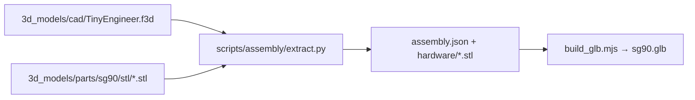

# 3D assembly model

A 3D model of the assembled robot, made from the same meshes you print, for a browser assembly viewer. CI builds it from the repository. Nothing generated is committed.



## How placements are found

The Fusion add-in exports each part in its **print** pose (flat on the bed, see [adding parts](adding-parts.md#print-ready-copy-print_layout)). To place it in the robot, the extractor reads the `.f3d` directly. It does not need Fusion:

- The design stores each component's bodies in that component's own frame, plus one solved transform per occurrence. That covers the assembled robot and the copies under `PRINT_LAYOUT`.
- A part's **print → assembled** transform is its assembled occurrence's transform times the inverse of its `PRINT_LAYOUT` occurrence's transform.
- **Hardware** (`Servo` ×5, `OLED`, `MainControlBoard`) has no exported mesh. Its mesh is tessellated from the design's own bodies and placed by its occurrence transform. Servos are named after the joint that seats them (`Head Servo` → `servo-head`, `Neck - Body` → `servo-neck`, `UpperArm Left/Right` → `servo-arm-left/right`, `ChairServo` → `servo-body`).

The `.f3d` format is not documented. It is read with [ezf3d](https://github.com/AlexSabaka/ezf3d) (MIT, pinned in [`scripts/assembly/requirements.txt`](../../scripts/assembly/requirements.txt)). Every placement is checked before it is used, and the run **fails** when a check fails:

| Check | Passes when |
| --- | --- |
| Print transform | At least 16 of one solid's B-Rep vertices, and 50 % of them or 100 in all, land within 0.05 mm of the exported STL's vertices. Round parts with few vertices (bell, lamp cap, coffee, diffuser) are checked by the bounding box of their surface instead, to 0.3 mm, or pass when at least 6 of their vertices and 85 % coincide. |
| Fallback | A part without a usable print transform (the mirrored upper arm, printed as `UpperArm.stl`, and the mug, whose print record is stale) is fitted to its STL with iterative closest point, then held to the same check. |
| Joints | Every named joint agrees with the transforms of the two occurrences it connects, to 0.05 mm. |

Not 100 % of vertices: a solid blob also keeps earlier solids of the timeline, and a part exported before a small parametric change, such as a screw pilot diameter, keeps its holes slightly elsewhere. The part itself does not move.

## Servo preset

The checks run against **one** preset's STLs: the one the `.f3d` was saved with (currently **SG90**). After changing the saved preset, run the extractor with the matching `--preset`. Other presets need the design saved at that preset.

## Run locally

Python 3.13 (ezf3d requires it) and Node 18+:

```bash
python3 -m venv .venv && .venv/bin/pip install -r scripts/assembly/requirements.txt
.venv/bin/python scripts/assembly/test_assembly.py
node scripts/assembly/test_build_glb.mjs
.venv/bin/python scripts/assembly/extract.py --preset sg90 --out artifacts/assembly/sg90
node scripts/assembly/build_glb.mjs artifacts/assembly/sg90/assembly.json artifacts/assembly/sg90.glb
```

`artifacts/` is git-ignored. CI runs the same commands (`assembly` job) and uploads `assembly.json` and the GLB as the `assembly-<sha>` artifact.

### `assembly.json`

```json
{
  "format": 1, "preset": "sg90", "units": "mm", "up": "+z",
  "parts": [{ "id": "Head", "mesh": "3d_models/parts/sg90/stl/Head.stl", "matrix": [16 numbers], "method": "print-layout" }],
  "hardware": [{ "id": "servo-head", "component": "Servo", "mesh": "hardware/Servo.stl", "matrix": [16 numbers] }],
  "joints_checked": [{ "name": "Head - Neck", "mismatch_mm": 0.0 }]
}
```

`matrix` is column-major, as glTF writes it, and takes the mesh to its assembled pose (mm, Z up). The GLB keeps that frame under a root node that turns Z up into glTF's Y up. It stores positions and indices only: the viewer computes normals. A mesh used more than once, such as the servos, is stored once.

## License

The generated model is made from the CAD and part exports, so it is covered by **CERN-OHL-S-2.0** like them ([LICENSING.md](../../LICENSING.md)). The scripts are MIT.
