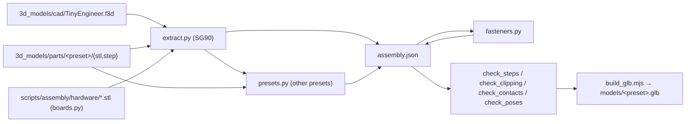

# 3D assembly model

The **[assembly viewer](https://jamro.github.io/tiny-engineer/assembly/)** shows the robot assembled from the same meshes you print. CI builds its 3D model from the repository on every Pages deploy. The only generated files in git are the electronics the CAD does not have ([below](#electronics-the-design-does-not-have)).



## Viewer

[`web/assembly/`](../../web/assembly/) on GitHub Pages, plain ES modules in [`web/js/assembly/`](../../web/js/assembly/), with Three.js from a CDN. It loads `models/<preset>.glb` (`sg90`, `fs0307`, `es9051`, `hd1370a`), which the [Pages workflow](../../.github/workflows/pages.yml) builds on deploy.

- **Build steps:** the build from [assembly.md](assembly.md), split into small steps. Each step shows the robot so far, slides the new parts in, frames them, and lists screws, the section photo and a link to the guide. Play, ← / →, or jump to a section. `#s=12` links to step 12.
- **Colours:** click a part, or its name in the list, and pick a filament colour or a custom one. Each print set (copper `PartsSetA`, black `PartsSetB`) has one control for all its parts. Defaults are the colours as designed ([order-parts.md](order-parts.md)).
- **Share:** changed colours live in the URL hash (`#c=Head.c8312c~Hat.c8312c`) and in the browser's storage. **Copy link** copies the URL.
- **Move:** a slider per servo joint, in the firmware's −1..1 pose scale ([robot-movement.md](../robot-movement.md)), and short loops built from the firmware's pose constants (typing, talking, ring the bell, wave). Each servo turns about its shaft, read from the model (`web/js/assembly/joints.js`): body → neck → head, body → hands. The range is a choice (±10° stock, ±25°, ±40°): calibrated limits differ per robot. Build steps show every servo at 90°.
- **Screws and nuts:** the robot's M2 screws and nuts, in their holes ([below](#screws-and-nuts)). In **Colours**, screws and nuts each come in **Silver** (zinc-plated or stainless) or **Black** (black oxide), the finishes M2 assortments are sold in; the choice lives in the URL hash (`#f=black.silver`: screws, then nuts) and the browser's storage. Build steps drive them in once the step's parts are home.
- **Print files:** **Download ZIP** packs the print files of the robot shown, at its servo preset ([below](#print-files)).
- **Explode** spreads the parts out (each screw stays in its part). **Electronics** hides the servos, OLED and control board; **Screws** hides the screws and nuts.

### Print files

[`download.js`](../../web/js/assembly/download.js) picks the files from the model's printed parts: **Home printer** takes one 3MF per part (two `UpperArm`, a mod's own parts in place of those it replaces) and the two testers in `print-first/`; **Print service** takes `PartsSetA`, `PartsSetB` and `LampDiffuser` as STL ([order-parts.md](order-parts.md)), stock robot only. The ZIP also holds `LICENSE`, `NOTICE` and a `README.txt` with each file's quantity and the colour picked in the viewer. The files are fetched from the site's `print/` folder, which the Pages workflow stages from `3d_models/parts/` and `mods/*/3d_models/parts/` ([`stage_print_files.mjs`](../../scripts/stage_print_files.mjs)), and zipped in the browser with [fflate](https://github.com/101arrowz/fflate) from the CDN.

### Steps

[`web/assembly/steps.json`](../../web/assembly/steps.json): sections that follow `assembly.md` (`doc` is the heading anchor, `photo` a file in `assembly_visuals/`), each with steps:

```json
{ "title": "Seat the OLED", "text": "…", "add": ["OLED"], "from": [0, 0, 40], "screws": "2 × M2×8" }
{ "title": "Lower the body onto BellyJoint", "text": "…", "add": [], "move": ["Belly", "Chest", "…"], "from": [0, 0, 70] }
```

- `add`: part ids from the model (`assembly.json`) that appear in this step. Every part is added exactly once.
- `move`: parts added earlier that move into place in this step, together: a sub-assembly built off the robot (the head before it goes on the chest, the whole desk before it meets the chair). Until this step they wait at `from`, added to any later moves of theirs, so a sub-assembly is built where it waits and travels as one piece.
- `from` / `fromEach`: where the added or moved parts slide in from, relative to where the step leaves them (mm, CAD frame: +x the robot's front, +y its left, +z up).
- `focus`: parts to frame (default: the parts the step adds or moves). `ghost`: parts drawn see-through (the desk while the board goes in).
- `allow`: overlaps this step lets through, `{ "parts": [a, b], "mm": 2.5, "why": "…" }`, for joints that only go together by flexing or tilting a part, which the viewer's straight slides cannot show. Top-level `fits` does the same for every step and for the finished robot: the servo shafts, modelled 0.3 mm over their printed pockets.

CI checks the steps against the extracted model (`check_steps.mjs`) and for clipping (below). When a part is added to the CAD, add it to a step.

Screws and nuts are not listed in `steps.json`: each one names its step in [`fasteners.json`](../../scripts/assembly/fasteners.json), and `withFasteners` (`steps.js`) adds it there. It rides in with the part its head sits on, then slides in along its axis once the step's parts are home (the last 40 % of the step), and moves with its parts in later steps.

### Screws and nuts

[`fasteners.py`](../../scripts/assembly/fasteners.py) adds the M2 screws and nuts of the [screw list](../../3d_models/README.md#screws) to each robot's `assembly.json`, from [`fasteners.json`](../../scripts/assembly/fasteners.json): per line, the part the head sits on, the part it threads into, the length, how many, and the step. It finds them in the parts' STEP exports at the robot's servo preset, placed where `assembly.json` has each part:

- Every circle of a pilot hole (radius 1.05 mm, `screw_thread_diameter` / 2, and the few other radii a line names: the Head's 2.4 mm clearance hole, the neck servo's pocket) lies on an axis. Circles of several parts on one axis are one hole stack; each part's circles, in pairs, span a stretch of it.
- A head sits at an end of one of the head part's holes with nothing of the stack just outside it (a counterbore floor, or the end of the stack), in the open (rays under the head leave the part), and the shaft runs inward. It is the line's screw when the shaft, at its length, reaches 1 mm into the part it threads into, or through a servo's tab.
- A head on a servo's tab sits where rays from the end of the Chest's hole leave the servo.
- A nut sits on the floor of a hex pocket (the Neck's, on the head servo's axis) or against the far side of the part (the bell's, under the desk).

A line that finds another count than it says fails the build, at every preset. Meshes: pan head 3.5 × 1.4 mm (JIS B 1122, as in M2 self-tapping assortments; at FS0307 and HD-1370A the servo tab's hole is 1.9 mm from the gearbox), 2 mm shaft with a point, ISO 4032 nut (4 mm across flats, 1.6 mm). Not drawn: the breakout boards' screws and nuts of the [modular build](assembly-modular.md) (the stock robot has the main control board), the optional second screw of the neck servo (one hole in the CAD), and the servos' own bag screws. Mods drop the screws through parts they remove or replace.

### Clipping check

[`check_clipping.mjs`](../../scripts/assembly/check_clipping.mjs) replays every step on the meshes. Each part that moves is walked along its path in 1 mm steps and tested against every part shown. Then the finished robot is checked pair by pair. Depth is measured on the triangles, not on bounding boxes: points spread 0.8 mm apart over one part's surface are tested inside the other (ray parity over a bounding volume hierarchy), and the deepest one sets the depth ([`clipping.mjs`](../../scripts/assembly/clipping.mjs), no dependencies). Faces that only touch measure 0, so mating parts pass. Anything deeper than 0.3 mm fails, unless `fits` or the step's `allow` covers that pair to that depth. Allowed overlaps are listed in the output.

```bash
node scripts/assembly/check_clipping.mjs artifacts/assembly/sg90/assembly.json web/assembly/steps.json [web/assembly/mods/<id>.json] [--tolerance 0.3] [--step 1]
```

```text
step 17 (belly 1) "Thread the three leads": Belly × servo-body clips 6.40 mm at 31 % of the move
```

A failure names the step (number overall, then section and number in it), the two parts, how deep they meet and where along the move. To fix one, slide the part in from a direction that clears what is already there, or build it into a sub-assembly that is mounted later with `move`. Stock takes about 35 s, the Halloween mod about a minute. `build.sh` runs it for stock and every mod. A mod's config can add `fits` for overlaps that come from how its parts are lined up with the stock robot (`align`).

### Pose check

[`check_poses.mjs`](../../scripts/assembly/check_poses.mjs) turns the parts about the servo shafts as the viewer does (`JOINTS` in [`poses.js`](../../web/js/assembly/poses.js), at ±25°) and checks parts that move relative to each other for clipping, at 90°, at rest and every 0.1 s through each animation loop. `fits` apply as in the step check. It also checks that the ring loop's strike lands the right hand on the bell or on the head of its M2×16, the bell's striker (within 0.5 mm, not in it). Screws and nuts turn with the part their head sits on (`withFollowers` in `poses.js`). About 80 s per preset; `build.sh` runs it for stock and every servo preset.

```bash
node scripts/assembly/check_poses.mjs artifacts/assembly/sg90/assembly.json web/assembly/steps.json [--tolerance 0.3] [--range 25]
```

The ring loop follows the firmware ([`ring.cpp`](../../src/animation/ring.cpp)): body turned fully right (−1), right hand up, strike, bounce to −5/9. The firmware strikes to −8/9 of a calibrated range; at the viewer's ±25° that stops 2 mm above the bell, so the viewer strikes to where the hand meets it: −0.97 at SG90 (on the bell's rim), and per servo preset in `RING_RIGHT_HITS` (on the screw head).

Local preview: build the GLB into `web/assembly/models/sg90.glb` (commands below), then `python3 -m http.server -d web 8000` and open `http://localhost:8000/assembly/`.

## Mods

A mod shows on the viewer when it has a config in [`web/assembly/mods/`](../../web/assembly/mods/) (`#m=<id>`, the **Model** switch). [`halloween.json`](../../web/assembly/mods/halloween.json) is the example:

- `f3d`, `parts`: the mod's design and its exported parts (`mods/<id>/3d_models/`). `extract.py --mod` reads only the parts the mod exports, checked against its STLs as for stock.
- `align`: how each group of the mod's parts lines up with the stock robot. A mod design is its own arrangement, not the stock robot's frame:
  - `component`: the mod keeps a stock component (the Halloween head keeps `Head`), so its frame is shared. Exact.
  - `centre` + `floor`: centre a part on a stock part and stand it on that part's floor (the lamp on the stock lamp's axis, the cauldron on the mug's spot). `check` fails the build if a footprint lands off.
  - `at`: a prop on the floor beside the desk.
- `replace` (`Mug` → `Pot`), `remove` (`Hat`), and same-id parts (`Head`, `LampBase`, …) take the stock parts' places. `colors` are the mod's defaults.
- `steps`: rewritten `sections`, `patch`ed steps (by index in the section) and `append`ed sections on top of `steps.json`. Replaced and removed ids follow automatically, in `add`, `move`, `allow` and `fits` alike. A mod part that rides on a stock sub-assembly must be in that sub-assembly's later `move`s: Halloween patches the body's move onto the chair so the pumpkin goes with the head.
- `fits`: overlaps of the mod's parts that the clipping check lets through, as in `steps.json`.

[`build.sh`](../../scripts/assembly/build.sh) builds every mod in that folder after the stock model, and checks its steps against its parts.

## How placements are found

The Fusion add-in exports each part in its **print** pose (flat on the bed, see [adding parts](adding-parts.md#print-ready-copy-print_layout)). To place it in the robot, the extractor reads the `.f3d` directly. It does not need Fusion:

- The design stores each component's bodies in that component's own frame, plus one solved transform per occurrence. That covers the assembled robot and the copies under `PRINT_LAYOUT`.
- A part's **print → assembled** transform is its assembled occurrence's transform times the inverse of its `PRINT_LAYOUT` occurrence's transform.
- **Hardware** (`Servo` ×5, `OLED`, `MainControlBoard`) has no exported mesh. Its mesh is tessellated from the design's own bodies and placed by its occurrence transform. The design's `MainControlBoard` is a simplified block; the viewer shows the board from its KiCad design instead (below). Servos are named after the joint that seats them (`Head Servo` → `servo-head`, `Neck - Body` → `servo-neck`, `UpperArm Left/Right` → `servo-arm-left/right`, `ChairServo` → `servo-body`).

The `.f3d` format is not documented. It is read with [ezf3d](https://github.com/AlexSabaka/ezf3d) (MIT, pinned in [`scripts/assembly/requirements.txt`](../../scripts/assembly/requirements.txt)). Every placement is checked before it is used, and the run **fails** when a check fails:

| Check | Passes when |
| --- | --- |
| Print transform | At least 16 of one solid's B-Rep vertices, and 50 % of them or 100 in all, land within 0.05 mm of the exported STL's vertices. Round parts with few vertices (bell, lamp cap, coffee, diffuser) are checked by the bounding box of their surface instead, to 0.3 mm, or pass when at least 6 of their vertices and 85 % coincide. |
| Fallback | A part without a usable print transform (the mirrored upper arm, printed as `UpperArm.stl`, and the mug, whose print record is stale) is fitted to its STL with iterative closest point, then held to the same check. |
| Joints | Every named joint agrees with the transforms of the two occurrences it connects, to 0.05 mm. |

The design is saved with the hands raised about 30° above the shoulders. The guide mounts the arms with the hand at shoulder height and the forearm pointing forward at 90° ([assembly.md](assembly.md#18-mount-arms-on-the-chest-servos)), so the extractor turns each arm (upper arm and forearm) 29° down about its servo's shaft (`ARM_REST_DOWN_DEG`) after the checks. The parts carry `"rest"` in `assembly.json`. 29°, not 30°: at rest (hands at their max, ±25°) the fingers then stay just clear of the laptop keyboard.

Not 100 % of vertices: a solid blob also keeps earlier solids of the timeline, and a part exported before a small parametric change, such as a screw pilot diameter, keeps its holes slightly elsewhere. The part itself does not move.

### Electronics the design does not have

[`boards.py`](../../scripts/assembly/boards.py) draws them as coloured STLs (colours in the attribute bytes, shown as vertex colours), committed in [`scripts/assembly/hardware/`](../../scripts/assembly/hardware/). After a change to the board or the script, run `python3 scripts/assembly/boards.py`; `test_boards.py` fails while the committed meshes are stale. The geometry helpers it shares with the screws and the preset servo are in [`meshes.py`](../../scripts/assembly/meshes.py).

- **Main control board**, from [`main-control-board.kicad_pcb`](../../hardware/boards/main-control-board/main-control-board.kicad_pcb), read directly (numpy only, no KiCad): the rev 3 outline and stack-up with its drilled holes, red mask, HASL pads, the silkscreen's lines and logo (not its text: the file keeps no outlines for it), and a part on every footprint. The five EasyEDA models of the project library (PCA9685, MAX98357A, TPS259571, USB-C, servo header) are used as they are; the parts KiCad draws from its own library, which is not in the repo, are built from the footprint and data sheet sizes: 2.54 mm sockets (8.5 mm) and headers (2.5 mm body, 0.64 mm pins), the 10 × 10.5 mm electrolytic, the 1812 fuse, 0603 parts, the JST SH and PicoBlade connectors. It is written in the frame of the design's `MainControlBoard`, a simplified block of the older, 10 mm shorter board (KiCad x, y → 120 − y, 183.5 − x): its three M2 holes and the ESP32 socket rows land on the design's, which the extractor checks.
- **ESP32-C3-Zero**, from Waveshare's drawing: a 23.5 × 18 × 1 mm PCB, corners R1, two columns of nine drilled and castellated pins 1.38 mm in from the long edges at 2.54 mm, and the USB-C receptacle 1.58 mm past the short edge. Chip, regulator, crystal, ceramic antenna, BOOT and RESET buttons and the WS2812 LED are placed and sized from Waveshare's photographs. The 5 V column goes in J7, which carries 5 V, GND and 3.3 V ([expected-nets.yml](../../hardware/boards/main-control-board/expected-nets.yml)), USB-C toward the front of the desk. That puts RESET under `LampButton` and the LED on the lamp's axis, as [§13](assembly.md#13-esp32-powerap-smoke-test-and-lampbase) has it.
- **Pin headers** (`ESP32-pin-headers`): two 1 × 9 male headers, 2.5 mm body under the module, 0.64 mm pins 3 mm up through its holes and 6 mm down into the sockets. The step *Solder the pin headers* builds module and headers off the robot; the next one pushes them into the sockets.

The extractor seats the module on the design's socket stack, which leaves it on the desk's ledge under `LampBase`, then puts the KiCad board in the design board's place, hanging from the headers: the sockets' tops one header body (2.5 mm) below the module, 0.5 mm lower than the design's simplified stack. `presets.py` keeps both (`design_offset`, `esp32_seat` in `assembly.json`).

## Servo preset

The extractor reads **one** preset: the one the `.f3d` was saved with (currently **SG90**), and checks it against that preset's STLs. After changing the saved preset, run it with the matching `--preset`.

The other presets (FS0307, ES9051, HD-1370A; the viewer's **Servo** switch, `#p=fs0307`) come from [`presets.py`](../../scripts/assembly/presets.py). Fusion places every component by its joints, outward from the body servo, which never moves; `presets.py` follows the same joints at the other preset:

- **Servo frames** follow the servo's own dimensions from [`servos.json`](../../3d_models/fusion/TinyEngineerTools/servos.json): the design's servo is blocks and a shaft with fixed clearances (0.6 mm on body, depth and tab thickness, 0.3 mm on the shaft), its shaft top at y 0.6 of its frame. Its mesh at the preset is drawn from the same sizes, with the tabs' screw holes where the design has them (`mount_hole_radius`, on the tab's centre line moved out by `mount_hole_width_offset`).
- **Frames on printed parts** move with the feature they sit on, found in the part's STEP export at both presets (`3d_models/parts/<preset>/step/`, in the component's own frame): a part that only moves (lamp, bell, mug) by its one translation; otherwise by the features around the frame that move rigidly, preferring the feature the frame is on (a recess's circle); a vertex, a midpoint of two vertices, or a point on a circle's axis.
- **Where a frame cannot be moved reliably** (the chest's servo pack: its servos sit in their pockets with clearance), the parts joined by exact joints are placed together by their contacts with the parts already placed, axis by axis. The run lists the joints it overrode this way.
- Each part's STL is then fitted to its STEP vertices for the print transform.

It is checked against the design's history: `TinyEngineer.f3d` is saved at FS0307 at 22afc31 and at SG90 at 268ad4b. From either one, with its commit's exports, `presets.py` places every component of the other to 0.001 mm (`test_presets.py --history`). The presets then go through the same checks as SG90 (steps, clipping, and [`check_contacts.mjs`](../../scripts/assembly/check_contacts.mjs): every two parts that touch in the SG90 robot still touch). The pose check runs at every preset too; the ring strike stops where that preset's hand meets its bell (`RING_RIGHT_HITS` in `poses.js`). Mods are built for SG90 only.

```bash
python3 scripts/assembly/presets.py --preset fs0307 --base artifacts/assembly/sg90 --out artifacts/assembly/fs0307
node scripts/assembly/check_contacts.mjs artifacts/assembly/sg90/assembly.json artifacts/assembly/fs0307/assembly.json
```

## Run locally

Python 3.13 (ezf3d requires it) and Node 18+:

```bash
python3 -m venv .venv && .venv/bin/pip install -r scripts/assembly/requirements.txt
# unit tests (seconds)
.venv/bin/python scripts/assembly/test_assembly.py
.venv/bin/python scripts/assembly/test_presets.py --history
.venv/bin/python scripts/assembly/test_fasteners.py
.venv/bin/python scripts/assembly/test_boards.py
node scripts/assembly/test_build_glb.mjs
node scripts/assembly/test_viewer.mjs
node scripts/assembly/test_clipping.mjs
# one robot, step by step
.venv/bin/python scripts/assembly/extract.py --preset sg90 --out artifacts/assembly/sg90
.venv/bin/python scripts/assembly/fasteners.py artifacts/assembly/sg90/assembly.json
node scripts/assembly/check_clipping.mjs artifacts/assembly/sg90/assembly.json web/assembly/steps.json
# everything: every preset and mod, all checks -> web/assembly/models/
PYTHON=.venv/bin/python scripts/assembly/build.sh
```

`artifacts/`, `web/assembly/models/` and `web/print/` are git-ignored. CI runs the same commands (`assembly` job) and uploads `assembly.json` and the GLB as the `assembly-<sha>` artifact.

### `assembly.json`

```json
{
  "format": 1, "preset": "sg90", "units": "mm", "up": "+z",
  "parts": [{ "id": "Head", "mesh": "3d_models/parts/sg90/stl/Head.stl", "matrix": [16 numbers], "method": "print-layout" }],
  "hardware": [
    { "id": "servo-head", "component": "Servo", "mesh": "hardware/Servo.stl", "matrix": [16 numbers] },
    { "id": "screw-hat-1", "component": "M2x8", "mesh": "hardware/M2x8.stl", "matrix": [16 numbers], "source": "fastener",
      "fastener": { "kind": "screw", "size": "M2×8", "parent": "Hat", "parts": ["Hat", "Head"], "step": "Close the head with the hat", "from": [0, 0, 10.8] } }
  ],
  "joints_checked": [{ "name": "Head - Neck", "mismatch_mm": 0.0 }]
}
```

`matrix` is column-major, as glTF writes it, and takes the mesh to its assembled pose (mm, Z up). A screw's mesh has its head on +z from the seat and its shaft along −z; `from` is where it starts its slide in its step. The GLB keeps that frame under a root node that turns Z up into glTF's Y up. It stores positions, indices and, for the boards, vertex colours: the viewer computes normals. A mesh used more than once, such as the servos, is stored once.

## License

The generated model is made from the CAD, the part exports and the board design, so it is covered by **CERN-OHL-S-2.0** like them, as are the committed meshes in `scripts/assembly/hardware/` ([LICENSING.md](../../LICENSING.md)). The scripts are MIT.
