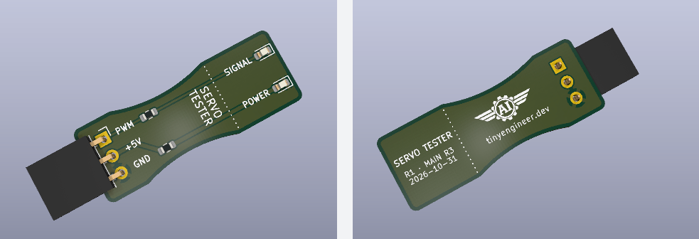

# PCBA test

Check a produced main control board rev 3 with a golden ESP32-C3-Zero and one operator. The test is compatible with main control board rev 3. The product firmware cannot do this check.

The golden module stays with the tester. The ESP32 must already run the test firmware. How to get one is below. Do not ship that module on a board.

## Get an ESP32 with the test firmware

If you already have an ESP32-C3-Zero with the test firmware, skip this section.

The ESP32 must already run the test firmware. The product firmware cannot run this test. The script and the page do not flash the module.

Seat a Waveshare ESP32-C3-Zero on a main control board. Match the USB mark. Plug a USB-C data cable into the board socket, not the ESP32 socket. From the repo root:

```bash
pio run -e pcba-test -t upload
```

When the test firmware is running, the onboard LED stays steady white.

The module LED stays steady white while the test image has power, including after a failed PCA probe, a verdict, and `q`. Steady white means the test image is running. It is not the board verdict. Judge the board by the ear on J1 and the plug lamps. Unplugging USB is what turns the module LED off.

## Run the script

Python 3 and pyserial. From the repo root:

```bash
python3 -m pip install pyserial
python3 scripts/pcba_test.py
```

The script prints a header, and a prepare card. It opens the board USB port. If that port is busy, the script says so and waits. Close the other program using the board. Keys match the page: Enter accepts a step, `n` rejects it. On SPEAKER, `+` is louder and `-` is quieter. After `RESULT`, unplug USB for the next board, or `q` to stop.

The other path is the web tester: [https://tinyengineer.dev/pcba_test](https://tinyengineer.dev/pcba_test). Chrome or Edge only. If the browser cannot open a serial port, the page says so and names `python3 scripts/pcba_test.py`.

## Testing board



The testing board seats on one servo column at a time. The top pin is yellow (SIG). The middle pin is red (5 V). The bottom pin is GND. Before each plug, read the pin labels on both boards and make sure they match: PWM to PWM, 5 V to 5 V, and GND to GND.

During `servos` test step, signal is on all five servo outputs. Take the testing board and plug it into one column at a time: HEAD, NECK, ARM L, ARM R, and BODY. On every column, red stays on and yellow pulses.

## What you see

The first test step card is prepare. Do that, then connect the board. The next card waits until the board is on USB, then waits for Enter before the first test step.

1. Take the board.
2. Plug in the ESP32. Match the USB mark on the board.
3. Plug the speaker into the JST speaker port.
4. Connect USB to the board. Use the board socket, not the ESP32.

Power-on is a short beep-beep, then silence. The next card is:

```
CONNECTED

The board is connected.

Enter = continue
```

Enter starts step `1/3`. `n` rejects a step. On a test step that is `Enter = good` and `n = bad`. On SPEAKER, `+` is louder and `-` is quieter. The card shows `+ = louder` and `- = quieter`, plus the level, from `Volume 1/10` through `Volume 10/10`. The tone keeps playing.

| Card | What you do | Look |
| --- | --- | --- |
| `1/3` `tone` | Speaker on the JST speaker port. `+` louder, `-` quieter. | A repeating tone until Enter or `n`. |
| `2/3` `servos` | Signal is on all five servo outputs. Plug the testing board into one column at a time: HEAD, NECK, ARM L, ARM R, and BODY. Match the pin labels on both boards. Check the LEDs on every column. | Red stays on and yellow pulses. |
| `3/3` OE OUTPUT ENABLE | Look at the testing board on one column. No need to test each servo column. | The red LED stays on. Only the yellow LED goes out. |

A column whose yellow LED does not pulse is a failure. Judge every column before Enter.

## Keys

`n` shows `FAIL` and the menu `r`, `c`, `a`.

- `r` retries the step and drops that failure. On screen: `r = try this step again`.
- `c` keeps the failure and goes on. On screen: `c = keep the fail, go on`.
- `a` clears the board and returns to CONNECTED without unplugging. Enter starts the test again. On screen: `a = start this board over`.

After `RESULT PASS` or `RESULT FAIL`, the card says to unplug USB for the next board, or `q` to stop. The host stays open and attaches when the port returns. `q` prints `STOP`. `n` after the verdict does nothing.

`RESULT PASS` covers the speaker, the five servo columns, and output enable. It does not cover J2, J3, J4, the OLED, Wi-Fi, or a 2 A load. A fault in those can still be present.

A failed PCA probe prints `FAIL pca` and `RESULT FAIL pca`, with no beep. The verdict card keeps the explanation: the PCA9685 probe failed at I2C 0x40, the chip drives the servos so the board stops before the speaker test, seat the ESP32 on the USB mark, keep VCC at 3.3 V rather than 5 V, and solder GND, SDA, and SCL. There is no `r` / `c` / `a`. Unplug or `q`, same as any other verdict.
