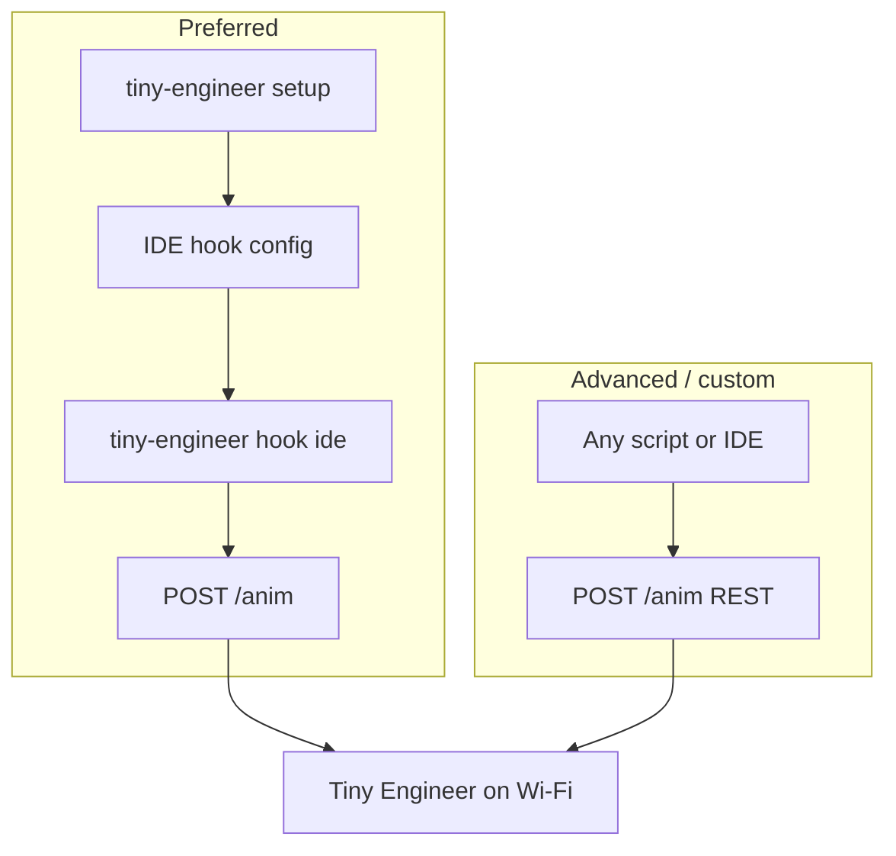

# Integrating Tiny Engineer

Tiny Engineer is a desk robot controlled over **Wi‑Fi HTTP** and/or **USB serial**. Prefer the unified **`tiny-engineer` CLI** for Cursor, Claude Code, and Antigravity hooks. For custom agents, other IDEs, or scripts, call the **REST API** or the serial protocol.

HTTP: robot on the same network; base URL `http://tiny-engineer.local` (or OLED IP). Full HTTP reference: [`api.md`](api.md). USB serial (corporate Wi‑Fi bans, USB-only mode): [`serial.md`](serial.md).

| Path | Best for | How |
|---|---|---|
| **`tiny-engineer` CLI** (default) | Cursor, Claude Code, Antigravity hooks | `tiny-engineer setup` → `hook <ide>` → anim over HTTP or serial |
| **REST API** (advanced) | Custom agents, other IDEs, CI | `POST /anim?name=…` ([`api.md`](api.md)) |
| **USB serial** | No Wi‑Fi / USB-only device | `--transport serial` ([`serial.md`](serial.md)) |



Prerequisites: flash firmware, join 2.4 GHz Wi-Fi, confirm `http://tiny-engineer.local/health` (or the OLED IP) responds.

---

## 1. Unified CLI (default)

Package: [`packages/tiny-engineer-cli`](../packages/tiny-engineer-cli/). Bin name: **`tiny-engineer`**.

Supported IDEs: **Cursor**, **Claude Code**, **Antigravity** — one CLI (`tiny-engineer setup` / `hook <ide>`). No separate per-IDE packages for new installs.

Maps IDE hook events to poses and POSTs `/anim`. Also installs/uninstalls hook entries, checks wiring (`doctor`), and can `anim` / `play` without writing your own HTTP client.

### Install / run

Published on npm as [`tiny-engineer`](https://www.npmjs.com/package/tiny-engineer) (no repo clone).

```bash
npx -y tiny-engineer --help
npx -y tiny-engineer setup
npx -y tiny-engineer setup cursor --yes
npx -y tiny-engineer doctor
```

- Cold `npx` can be slow: `setup` writes hook **`timeout` ≥ 30**.
- Connection prefs (transport, URL, port, token) live in **user config** (`~/.config/tiny-engineer/env` on macOS/Linux, `%APPDATA%\tiny-engineer\env` on Windows; override with `TINY_ENGINEER_CONFIG_DIR`). Setup never edits project `.env`.
- Load order: flag → process env → project `.env` (override) → user `env` → defaults. Setup and `doctor` warn when project `.env` overrides user config.
- Optional: `--url http://192.168.x.x` (default `TINY_ENGINEER_URL`, else `http://tiny-engineer.local`).
- Host transport: `--transport http|serial` or `TINY_ENGINEER_TRANSPORT` (setup writes this into user config). Default `http`. Distinct from the device AP **Connection** step (`link_mode`).
- Auth (HTTP only): if the device has an `access_token`, set `TINY_ENGINEER_TOKEN` (process env, user config, or project `.env` override). The CLI sends `Authorization: Bearer …`. A user/process token is not sent when the URL came only from project `.env` (request continues without Bearer; stderr warns). Serial skips Bearer.
- Prefer registry `npx` over `npx github:…` (SSH often fails in IDE hooks).

**This firmware repo (local CLI development):**

```bash
node packages/tiny-engineer-cli/bin/tiny-engineer.js setup
node packages/tiny-engineer-cli/bin/tiny-engineer.js doctor
```

That checkout is the `dev` channel. A registry install is the `npm` channel. See [Serial host daemon](#serial-host-daemon).

### Serial host daemon

Serial commands (`anim`, `play`, `watch`, `monitor`, settings, doctor, hooks, and the rest) auto-start `tiny-engineer daemon` and talk to it on a local socket. The daemon keeps the USB port until `tiny-engineer daemon stop`. HTTP commands do not start it. Closing the terminal does not stop it.

`tiny-engineer daemon status` prints the channel and package root. Registry installs (`npx -y tiny-engineer`, or a global install) are `npm`. `node packages/tiny-engineer-cli/bin/tiny-engineer.js` from this repo is `dev`. A dev checkout replaces a running npm daemon. An npm command leaves a dev daemon running. `daemon restart` from the tree you want replaces a different checkout.

`tiny-engineer daemon stop` frees the port for other serial tools. `tiny-engineer daemon stop --yield` also refuses auto-start for 180 seconds so a firmware upload can open USB. `tiny-engineer daemon start` clears that yield. Details: [`serial.md`](serial.md).

### Setup wizard

```bash
npx -y tiny-engineer setup                  # interactive: pick IDEs
npx -y tiny-engineer setup cursor --yes
npx -y tiny-engineer setup --all --yes --url http://192.168.1.10
npx -y tiny-engineer doctor
npx -y tiny-engineer uninstall cursor --yes # remove only Tiny Engineer hook entries
```

`setup` merges hook commands into the project (Cursor `.cursor/hooks.json`, Claude Code `.claude/settings.json`, Antigravity `.agents/hooks.json`) using `npx -y tiny-engineer hook <ide>`, and writes connection prefs into **user config** (labeled as global vs project in the wizard). It does not delete foreign hooks and does not edit project `.env`. Uninstall removes hooks only (no `--purge-env`).

This firmware repo already ships configs pointing at the **local** CLI bin for developing the package.

### Hook smoke test

```bash
echo '{"hook_event_name":"stop"}' | npx -y tiny-engineer hook cursor
```

Cursor deep dive (event table, sample `hooks.json`): [`hooks.md`](hooks.md).

### Manual anim / play

```bash
tiny-engineer anim ring
tiny-engineer play /tmp/clip.wav
tiny-engineer play /tmp/clip.wav --name thinking
```

WAV for `/play`: 16-bit mono PCM at 22050 Hz. Details: [`api.md#post-play`](api.md#post-play).

### Speaking through the robot (skill)

Install the shared [`tiny-engineer-play`](../skills/tiny-engineer-play/SKILL.md) skill (`curl` + `POST /play`). Same skill works in Claude Code, Cursor, and Antigravity:

```bash
mkdir -p ~/.claude/skills && ln -s "$PWD/skills/tiny-engineer-play" ~/.claude/skills/                         # Claude Code
mkdir -p ~/.cursor/skills && ln -s "$PWD/skills/tiny-engineer-play" ~/.cursor/skills/                         # Cursor
mkdir -p ~/.gemini/antigravity/skills && ln -s "$PWD/skills/tiny-engineer-play" ~/.gemini/antigravity/skills/  # Antigravity
```

---

## 2. REST API (advanced / custom)

Call the board directly when you are not using the supported IDE hooks, or when you need full control of mapping and timing. Works with any AI IDE, CI, shell hooks, or plugin that can `POST` over HTTP.

### Main call

```bash
curl -X POST "http://tiny-engineer.local/anim?name=typing"
```

| `name` | Typical use |
|---|---|
| `typing` | Agent writing / editing / running tools |
| `reading` | Agent reading files / context |
| `thinking` | Agent reasoning / waiting on a long step |
| `ring` | Turn finished (attention ping) |
| `welcome` | Session start / greeting |
| `wakeup` | Sleep-inertia wake (eyes/head) |
| `sleep` | Force sleep (eye close + OLED off) |
| `attention` | Needs user input |
| `error` / `abort` | Failure / cancel |
| `dead` | Out of power (`dead.wav`, then X X hold) |
| `none` | Idle / clear pose |

Firmware holds each pose ≥1s and keeps only the **latest** pending switch — spam-safe. Auth is optional: if you set an access token on the device, send `Authorization: Bearer <token>` (check `GET /auth` for `required`). Prefer short timeouts (e.g. 2s) and ignore network errors so the agent never stalls if the robot is offline.

### Minimal examples

**Shell**

```bash
curl -4 -sS -m 2 -X POST "http://tiny-engineer.local/anim?name=reading" >/dev/null || true
```

**JavaScript (Node 18+)**

```js
await fetch("http://tiny-engineer.local/anim?name=thinking", {
  method: "POST",
  signal: AbortSignal.timeout(2000),
}).catch(() => {});
```

**Python**

```python
import urllib.request
urllib.request.urlopen(
    urllib.request.Request(
        "http://tiny-engineer.local/anim?name=typing",
        method="POST",
    ),
    timeout=2,
)
```

Wire these into your IDE’s hook / plugin / lifecycle events (prompt submitted → `reading`, tool use → `typing`, turn end → `ring`, etc.). Mapping is yours; the robot only cares about `name`.

Health check (no motion):

```bash
curl http://tiny-engineer.local/health
```

Full route list (tests, servo, web UI, `/play`): [`api.md`](api.md).

---

## Which to choose?

- **Cursor / Claude Code / Antigravity** → unified CLI (`tiny-engineer setup`).
- **Custom agent, other IDE, CI, or no Node** → REST (`POST /anim`).
- Both paths hit the same firmware API; the CLI is a thin client.

---

## Deprecated bins

The old bins `tiny-engineer-cursor`, `tiny-engineer-antigravity`, and `tiny-engineer-claude-code` still run but are **deprecated**. Prefer `tiny-engineer` above. Migrate with `tiny-engineer setup`, then `tiny-engineer uninstall` to strip leftover hook entries. For custom mapping, use the [REST API](#2-rest-api-advanced--custom).

---

## Optional extras

Same `POST /anim` API. On macOS you can run a small host helper that POSTs `sleep` / `wakeup` when the screen locks or unlocks: [`macos-lock-unlock.md`](macos-lock-unlock.md). The robot does not need it.
