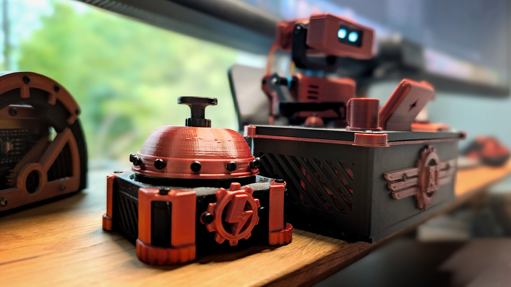

# Bell button

Standalone desk bell. The plunger closes a 6 mm momentary switch. Wire it to the push-button extension and the robot publishes button events, and can play `bell.wav`.

Assembly: [assembly guide](assembly.md).

Fusion source: [`3d_models/cad/TinyEngineerBellButton.f3d`](3d_models/cad/TinyEngineerBellButton.f3d). Printables: [`3d_models/parts/all/`](3d_models/parts/all/).

| Part | Role |
| --- | --- |
| `Base` | Housing and feet |
| `Bell` | Dome |
| `Button` | Plunger |
| `ButtonPocket` | Seat for the 6 mm switch |
| `Clamp` | Holds the switch |
| `CableTunnel` | Wire exit |
| `ActionEmblem` | Gear badge |

Screw holes use the stock M2 parameters (`screw_thread_diameter`, `screw_head_diameter`, `screw_head_height`).

## Hookup

Wire **GND** + one Extension-port GPIO (default **GP20**), enable **Push button** in the web UI **Extensions** page, and set **`button.down`** sound to **Bell**. Full wiring, pin options, events, and a CLI `rules add` example: [assembly §7](assembly.md#7-seat-button-and-wire-the-extension-port).

CAD under `3d_models/` is [CERN-OHL-S-2.0](../../3d_models/LICENSE). This file is [MIT](../../LICENSE).
