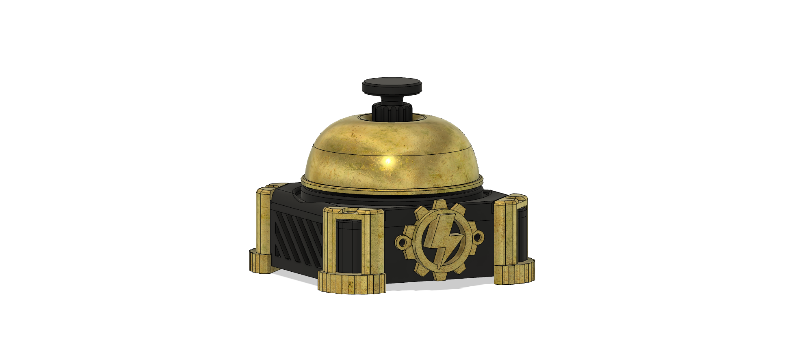

# Bell button

Standalone desk bell. The plunger closes a 6 mm momentary switch. Wire it to the push-button extension and the robot publishes button events, and can play `bell.wav`.

Fusion source: [`3d_models/cad/TinyEngineerBellButton.f3d`](3d_models/cad/TinyEngineerBellButton.f3d). No `3mf`, `stl`, or `step` exports yet.

| Part | Role |
| --- | --- |
| `Base` | Housing and feet |
| `Bell` | Dome |
| `Button` | Plunger |
| `ButtonPocket` | Seat for the 6 mm switch |
| `Clamp` | Holds the switch |
| `CableTunnel` | Wire exit |
| `ActionEmblem` | Gear badge |

Screw holes use the stock M2 parameters (`screw_thread_diameter`, `screw_head_diameter`, `screw_head_height`).

## Hookup

Two wires: the selected Extension-port pin and GND. Active-low, with the ESP32 internal pull-up. Pins: GP6, GP7, GP20 (default), GP21.

In the web UI, open **Extensions**, enable **Push button**, pick the pin, and save. Events (`button.down`, `button.up`, `button.click`, `button.double_click`, `button.long_click`) go out over WebSocket and serial. Each event can play `none`, `bell`, or `click`. See [docs/api.md](../../docs/api.md).

CAD under `3d_models/` is [CERN-OHL-S-2.0](../../3d_models/LICENSE). This file is [MIT](../../LICENSE).
