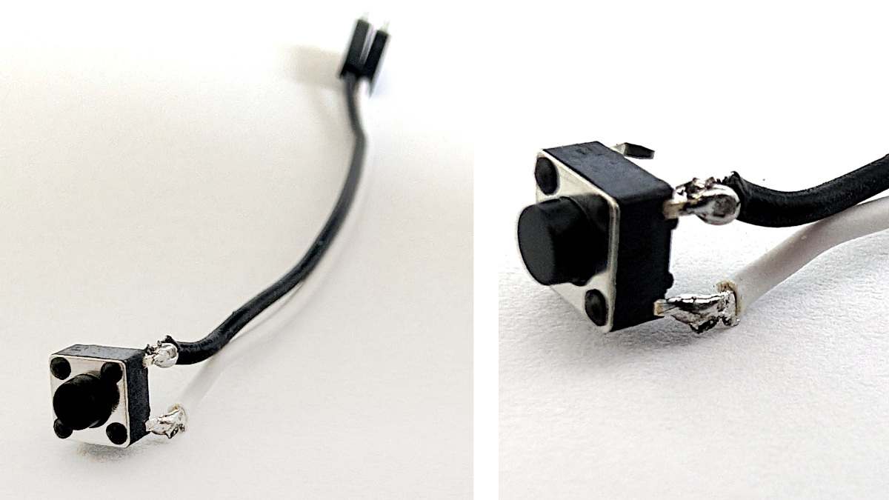
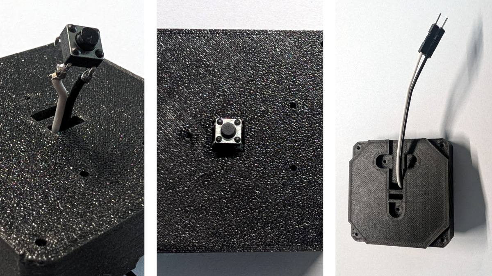
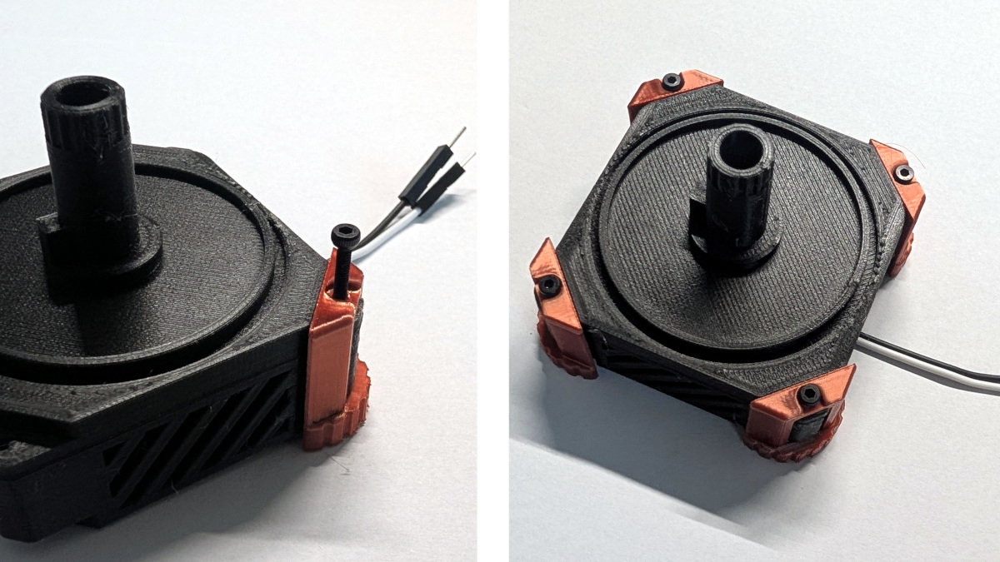
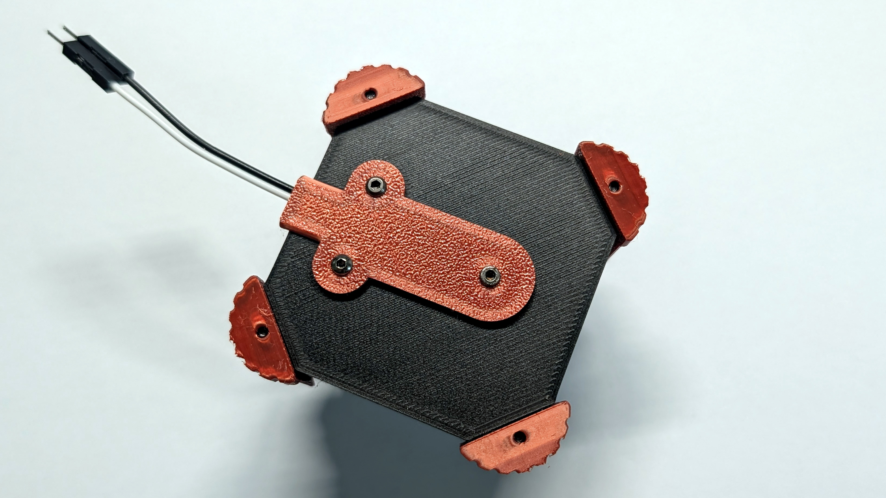
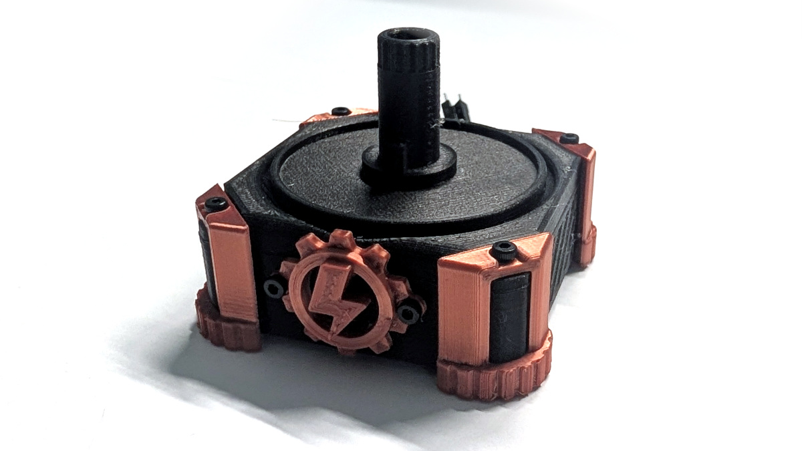
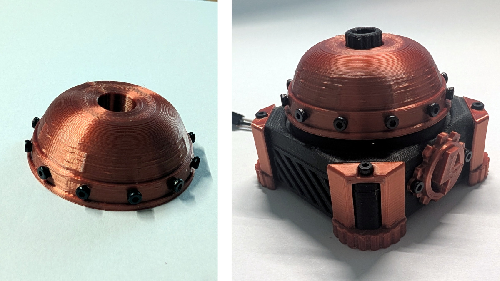
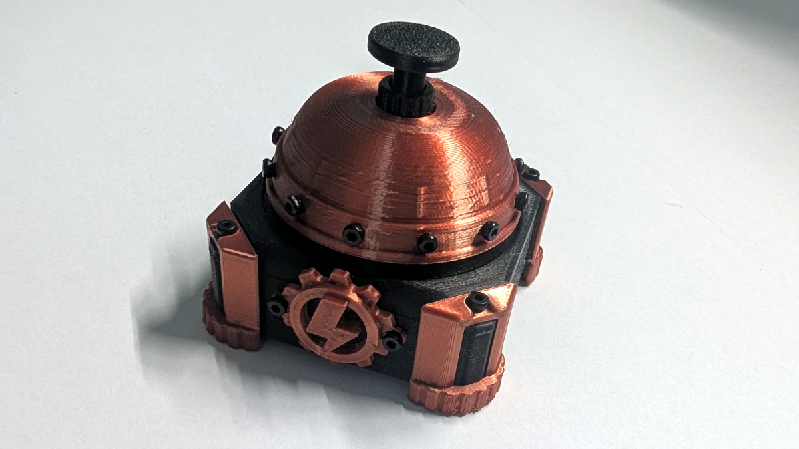

# Bell button assembly

How to print, assemble, and wire the Bell button mod. Needs a working Tiny Engineer with the main control board **Extension port** free (GND + one GPIO).

### Shopping list

Printables: [`3d_models/parts/all/`](3d_models/parts/all/). Fusion source: [`3d_models/cad/TinyEngineerBellButton.f3d`](3d_models/cad/TinyEngineerBellButton.f3d).

| Item | Qty | Notes |
| --- | --- | --- |
| `Base` | 1 | Print |
| `ButtonPocket` | 1 | Print |
| `Bell` | 1 | Print |
| `Button` | 1 | Print — plunger |
| `Clamp` | 4 | Print |
| `CableTunnel` | 1 | Print |
| `ActionEmblem` | 1 | Print — gear badge |
| 6×6 mm momentary tactile switch (4-pin) | 1 | Through-hole legs |
| Jumper wires, female DuPont end | 2 | Long enough to reach the Extension port; solder the free ends to the switch |
| M2×16 mm screws | 4 | `Clamp` posts |
| M2×8 mm screws (or nearby short) | 17 | 3× `CableTunnel` + 2× `ActionEmblem` + 12× decorative on `Bell` |

M2 threads into printed plastic — no nuts, no heat-set inserts. An M2 assortment covering **M2×8–M2×16** is enough if you already have the stock robot kit.


## 1. Solder jumper wires to the micro switch

The plunger closes a **6×6 mm momentary tactile switch** (4 pins). Solder **two jumper wires** to it before seating the switch in the printed parts.



1. Take one 6×6 mm tactile switch and two jumper wires (female DuPont ends work for the Extension port later).
2. Solder one wire to a pin on **one side** of the body, and the other wire to a pin on the **opposite** side — match the photo.
3. Leave the other two pins empty. Do **not** solder both wires to the same side of the body.

### Why four pins?

Electrically this switch is a **single contact** with only **two terminals**. The four legs are for PCB mounting stability.

- Pins on the **same side** of the plastic body are **always shorted** to each other inside the switch.
- Pins on the **opposite side** are the other terminal — also shorted to each other.
- Pressing the plunger connects the left pair to the right pair. Releasing opens that path again.

So you only need two wires: one on each side. Wiring both leads to the same side would leave the circuit permanently closed and the button would never open. The spare pair of legs can stay unsoldered; they are the same two nets.

Wire color does not matter yet. Later one lead goes to the selected Extension-port GPIO and the other to **GND** (active-low with the ESP32 internal pull-up).


## 2. Seat the switch in `Base`

`Base` has a rectangular slot on top for the switch body and a cable tunnel on the underside.



1. Feed the jumper wires through the slot in `Base` from the **top**, solder joints first.
2. Push the switch into the slot until it sits flush — plunger facing **up**, centered in the opening.
3. Flip `Base` over. Lay the wires into the recessed tunnel on the bottom so they lie flat against the part.


## 3. Mount `ButtonPocket` with four `Clamp`s

`ButtonPocket` sits on `Base` over the switch. Four `Clamp` posts lock the stack with **four M2×16 mm** screws.



1. Place `ButtonPocket` onto `Base` so it nests over the seated switch — center guide post pointing **up**.
2. Set one `Clamp` at each corner of `Base`.
3. Fasten each `Clamp` with **one M2×16 mm screw**, threading into the printed plastic. Do not overtighten.
4. Keep the jumper wires clear of the clamps as they exit the cable tunnel.


## 4. Fasten `CableTunnel`

`CableTunnel` covers the underside channel and holds the jumper wires flat against `Base`.



1. Flip the assembly so the underside of `Base` faces up.
2. Confirm the wires still lie in the recessed tunnel, then place `CableTunnel` over them — exit opening toward the cable exit edge of `Base`.
3. Fasten with **three short M2 screws** (**M2×8 mm** works). Do not pinch or crush the wires.


## 5. Mount `ActionEmblem`

The front face of `Base` has two mounting holes for the gear badge.



1. Place `ActionEmblem` on the front of `Base`, aligned with the two holes — badge upright.
2. Fasten with **two short M2 screws** (**M2×8 mm** works).


## 6. Fit `Bell`

The rim of `Bell` takes **twelve short M2 screws** for looks only. Then the dome seats on `ButtonPocket`.



1. Drive **twelve short M2 screws** (**M2×8 mm** works) into the holes around the bottom rim of `Bell`. These are decorative — they do not fasten anything.
2. Lower `Bell` onto `ButtonPocket`. Align the pocket inside `Bell` with the raised key on `ButtonPocket` so the dome seats fully. The key stops `Bell` from rotating.
3. The plunger should pass through the center opening of `Bell`.


## 7. Seat `Button` and wire the Extension port

Drop the printed plunger into the chimney, then plug the jumpers into the main control board.



1. Place `Button` into the center opening (chimney) of `ButtonPocket` so it rests on the micro-switch plunger and sticks up through `Bell`.
2. On the main control board **Extension port**, connect one jumper to **GND** and the other to a GPIO. Default firmware pin is **GP20** — use that unless you pick another allowed pin.
3. In the web UI open **Extensions**, turn **Push button** **on**, confirm the pin (default **GP20**; also allowed: GP6, GP7, GP21), and save. Without that toggle the switch does nothing. Change the pin there any time — move the signal wire to match.
4. In the same Extensions Events table, set the **`button.down`** sound to **Bell**. That plays `bell.wav` as soon as you press — the most natural desk-bell feel. Leave the other event sounds on **None** unless you want extra cues.

Active-low with the ESP32 internal pull-up. With the extension on, presses publish `button.down`, `button.up`, `button.click`, `button.double_click`, and `button.long_click` over WebSocket and serial. Map those events to a host program with the CLI, for example open Music on a click:

```bash
tiny-engineer rules add button.click -- /usr/bin/open -a Music
tiny-engineer rules list
```

More on rules and events: [docs/integration.md](../../docs/integration.md#event-rules), [docs/api.md](../../docs/api.md).
