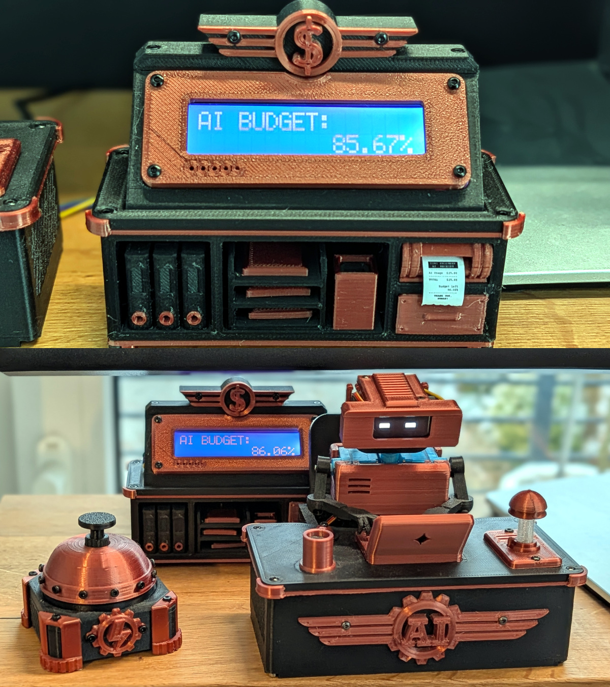

# LCD cabinet

Desk cabinet for a [Waveshare LCD1602 RGB Module](https://www.waveshare.com/lcd1602-rgb-module.htm). The display plugs into the robot’s I2C extension port. Text comes from the LCD1602 extension.

Fusion source: [`3d_models/cad/TinyEngineerLcdCabinet.f3d`](3d_models/cad/TinyEngineerLcdCabinet.f3d). Printables: [`3d_models/parts/all/`](3d_models/parts/all/).

| Part | Role |
| --- | --- |
| `DisplayCase` | LCD housing |
| `DisplayCover` | Bezel over the module |
| `CabinetBody` | Main shell |
| `CabinetBottom` | Base |
| `CabinetTop` | Lid |
| `CabinetTopPad` | Top deck |
| `Header` | Trim above the display |
| `CabinetEmblem` | Dollar badge |
| `Binder` | Front file prop |
| `Papers` | Front paper stack |
| `Bin` | Front drawer prop |

`lcd_cabinet_receipt.pdf` is the slip for the paper slot.

## Shopping list

| Item | Qty | Notes |
| --- | --- | --- |
| [Waveshare LCD1602 RGB Module](https://www.waveshare.com/lcd1602-rgb-module.htm) | 1 | I2C, RGB backlight. The supplied lead is a goldpin cable; see below |

## Assembly

1. Print every part under [`3d_models/parts/all/`](3d_models/parts/all/) (`3mf` or `stl`).
2. Fit the printed parts together. Open [`TinyEngineerLcdCabinet.f3d`](3d_models/cad/TinyEngineerLcdCabinet.f3d) and use it as the reference for how the pieces stack. Seat the LCD module in `DisplayCase` and close it with `DisplayCover`.
3. Replace the goldpin connector on the Waveshare cable with a Qwiic plug (JST SH, 4 pin, 1.0 mm) for **J3**. The module silkscreen order is not the Qwiic order. Match the signal names, not the wire colors:

   | Waveshare pin | J3 / Qwiic pin |
   | --- | --- |
   | GND | 1 — **GND** |
   | VCC | 2 — **+3.3V** |
   | SDA | 3 — **I2C SDA** |
   | SCL | 4 — **I2C SCL** |

   Pin 1 on a Qwiic plug is GND. Putting VCC on pin 1 swaps power and ground. J3 is 3.3 V logic; use the **+3.3V** pin, not a 5 V rail. Full header: [pinout § J3](../../docs/hardware/pinout.md#j3--i2c-extension-conn_extension-jst).
4. Plug the cable into **J3** on the main control board.
5. Open the Tiny Engineer web UI, go to **Extensions**, turn **LCD 1602** on, and save. The extension talks to this module at LCD address `0x3E`.

CAD under `3d_models/` is [CERN-OHL-S-2.0](../../3d_models/LICENSE). This file is [MIT](../../LICENSE).
